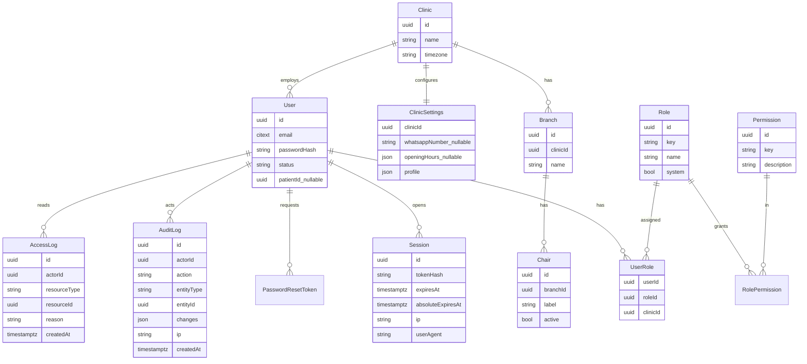
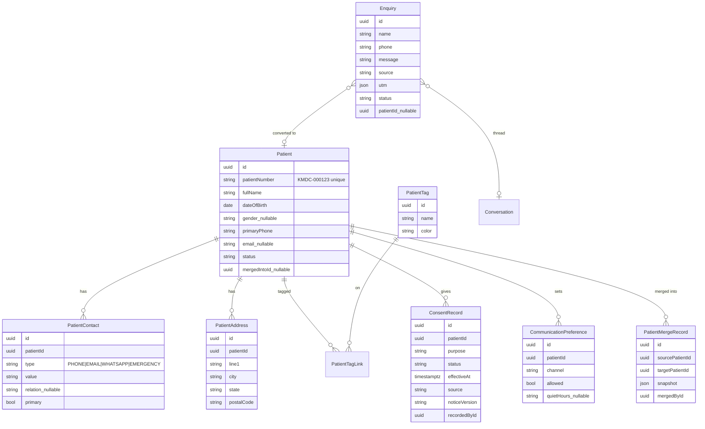
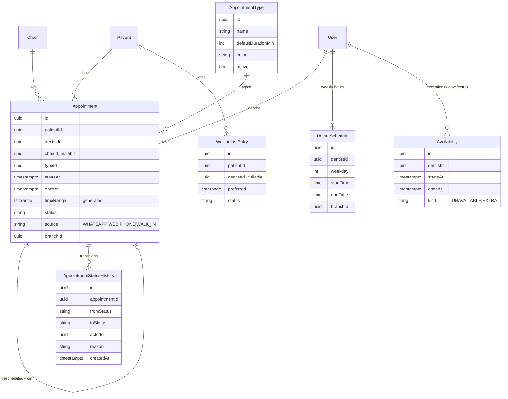
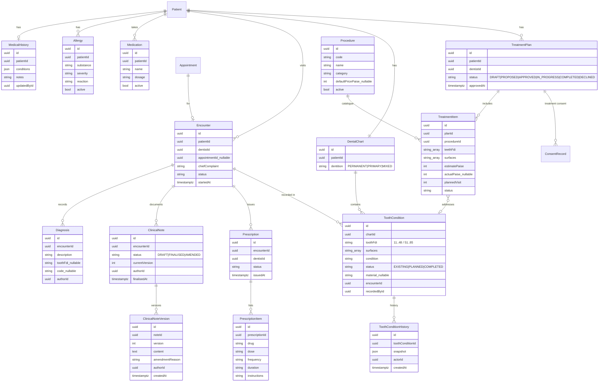
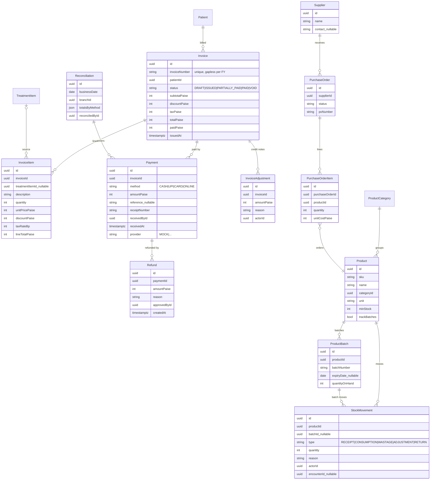
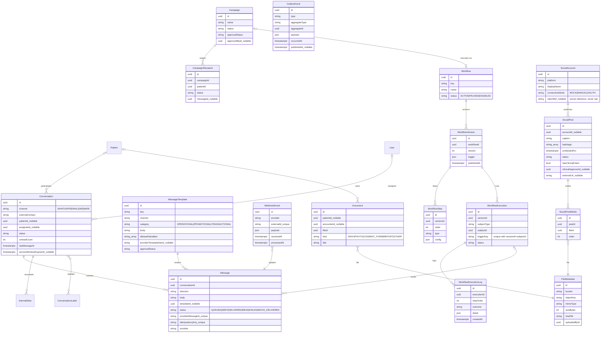

# Proposed ERD

**Status:** Proposed (Phase 0). This document becomes authoritative once each domain's Prisma schema
lands (Phases 4–10), and it must be updated alongside every migration.

Conventions: every table has `id uuid PK`, `createdAt`, `updatedAt` (except append-only tables, which
have `createdAt` only). Operational tables carry `clinicId`, and `branchId` where relevant.
Diagrams are split by domain for readability. Fields listed are the key ones; the full list is in
[`data-dictionary.md`](./data-dictionary.md).

## 1. Organisation, identity, audit

## 2. Patients, consent, enquiries

## 3. Scheduling

Constraint (raw SQL, ADR-009): `EXCLUDE USING gist ("dentistId" WITH =, "timeRange" WITH &&) WHERE (status in active set)`,
and the same for `"chairId"`.

## 4. Medical, clinical, dental chart, treatment

The spec lists `Tooth` and `ToothSurface` as model names. Teeth (FDI codes) and surfaces are a
**fixed reference vocabulary**, so they are implemented as validated enums/constants in
`packages/types`, not as tables. `ToothCondition` references them by code. This avoids 52+ redundant
rows per patient while keeping full per-tooth history.

## 5. Billing and inventory

## 6. Communication, automation, marketing, files

## 7. Key relationship notes

1. **Patient ⇄ User:** Patient-role users link to exactly one `Patient` via `User.patientId`. Staff users have no patient link.
2. **Merge:** merging sets `Patient.mergedIntoId` and `status=MERGED`. Child rows are re-pointed to the target inside one transaction, and a `PatientMergeRecord` snapshot allows audit and forensic reconstruction.
3. **Appointment → Encounter:** an encounter normally comes from an appointment. Walk-ins create both together.
4. **TreatmentItem → InvoiceItem:** billing copies the price at invoice time (a snapshot). Later plan edits do not change issued invoices.
5. **Message idempotency:** `idempotencyKey` is unique (e.g. `wf:{executionId}:step:{n}`), so a retried job cannot insert a second message.
6. **Deletion policy:** soft delete (`deletedAt`) only for Patient (anonymisation flow), User (deactivation) and catalogue entries. Clinical, financial, consent, audit and message rows are never deleted.
